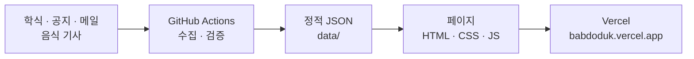

# 밥도둑 Babdoduk

**KAIST에서 오늘 뭐 먹지?** 무료 음식 일정, 이번 주 학식, 메뉴 고르기, 음식 이야기를 한곳에서 봅니다.

[사이트 열기](https://babdoduk.vercel.app) · [lab 미리보기](https://babdoduk-lab.vercel.app) · [인스타그램](https://www.instagram.com/babdodukms/)

## 화면

| 홈 | 오늘의 꽁밥 |
|---|---|
|  |  |
| 오늘의 꽁밥 달력과 학식 한 줄로 시작해요. | 지금 참여할 수 있는 무료 음식 일정과 이번 주 학식. |
| **밥도둑 매거진** | **소식·이벤트** |
|  |  |
| 음식 이야기와 '오늘 뭐 먹지?' 메뉴 고르기. | 밥도둑이 연 활동과 지난 기록. |
| **먹방 월드컵** | **역사** |
|  |  |
| 700개가 넘는 메뉴 중 32개가 맞붙는 놀이. | 밥도둑이 걸어온 길. |


## 어떻게 돌아가나



- 빌드 단계가 없는 정적 사이트예요. 브라우저는 같은 사이트의 JSON만 읽어요.
- 데이터는 만든 시점의 스냅숏이라, 화면에 날짜나 마지막 변경 시각을 함께 보여 줘요.
- 생성이나 검증이 실패하면 이전 파일이 그대로 남아요.

## 시작하기

```powershell
python scripts\check_ggongbab_ui.py --serve   # http://127.0.0.1:8000 에서 미리보기
python -m pytest tests -q                       # 테스트
python scripts\validate_content.py              # 데이터 검증
python scripts\check_site_ui.py                 # 모든 페이지 화면 검사
```

## 작업 규칙

1. 최신 `origin/lab`에서 작업 브랜치를 만들어요.
2. `lab`에 합쳐 https://babdoduk-lab.vercel.app 에서 한·영, 휴대폰·데스크톱으로 확인해요.
3. 소유자가 승인하면 승인된 커밋만 `main`으로 옮겨요. lab 전체를 main에 합치지 않아요.
4. 배포 뒤에는 back-sync로 `lab`을 본편과 맞춰요. 아래 명령의 출력이 없어야 해요.

```powershell
git log --format='%h %an %s' origin/lab..origin/main | Select-String -NotMatch 'babdoduk-content-bot'
```

규칙 전체는 [AGENTS.md](AGENTS.md), 배포는 [docs/DEPLOYMENT_AND_BRANCHES.md](docs/DEPLOYMENT_AND_BRANCHES.md),
브랜치 정리는 [docs/REPOSITORY_HYGIENE.md](docs/REPOSITORY_HYGIENE.md)에 있어요.

## 문서

| 알고 싶은 것 | 문서 |
|---|---|
| 페이지·데이터·파이프라인·수집·검증·배포 자세히 | [docs/GUIDE.md](docs/GUIDE.md) |
| 제품 범위 · 디자인 · 구조 | [PRD.md](PRD.md) · [DESIGN_SYSTEM.md](DESIGN_SYSTEM.md) · [ARCHITECTURE.md](ARCHITECTURE.md) |
| 데이터 파일 계약 | [docs/DATA.md](docs/DATA.md) |
| 오늘의 꽁밥 | [docs/GGONGBAB_PAGE.md](docs/GGONGBAB_PAGE.md) |
| 학식 | [docs/KAIST_MENU.md](docs/KAIST_MENU.md) |
| 매거진 | [docs/MAGAZINE_DISCOVERY.md](docs/MAGAZINE_DISCOVERY.md) · [docs/MAGAZINE_SOURCES.md](docs/MAGAZINE_SOURCES.md) |
| 소식·이벤트 쓰는 법 | [docs/EVENT_DETAIL_FIELDS.md](docs/EVENT_DETAIL_FIELDS.md) |
| 화면 기준 이미지 | [docs/VISUAL_BASELINES.md](docs/VISUAL_BASELINES.md) |

## 라이선스

코드는 [MIT](LICENSE), 매거진 자료원 등록부(`scripts/discovery/sources.json`)는 CC0 1.0이에요.
밥도둑 이름과 로고, `images/`의 사진·캐릭터, `data/`의 생성 데이터는 각 권리자의 것이에요.
먹방 월드컵 사진은 위키미디어 공용의 자유 이용 사진으로, 작가와 라이선스를 사진마다 표시해요.
