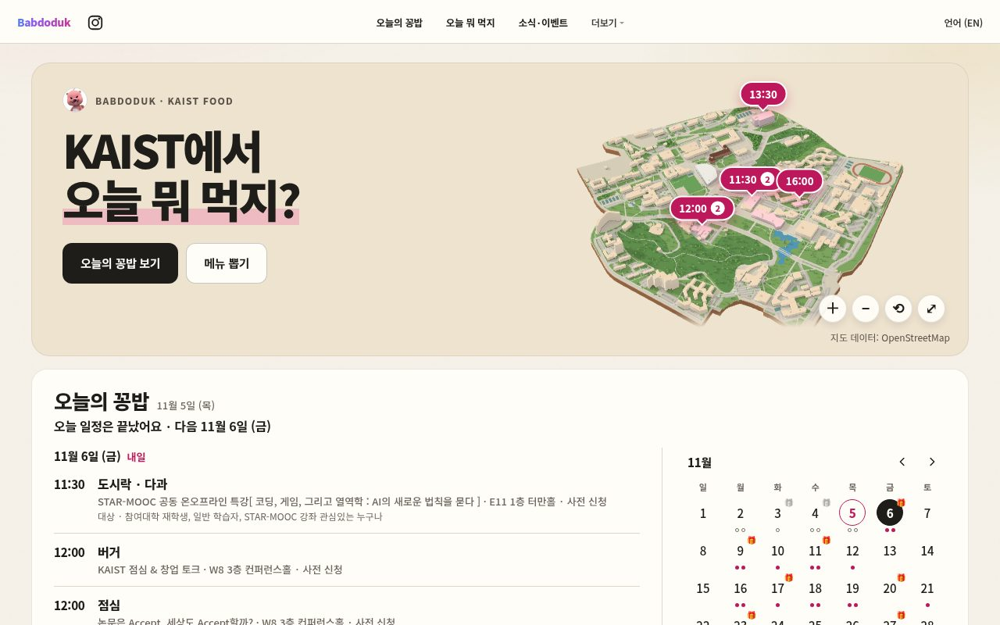
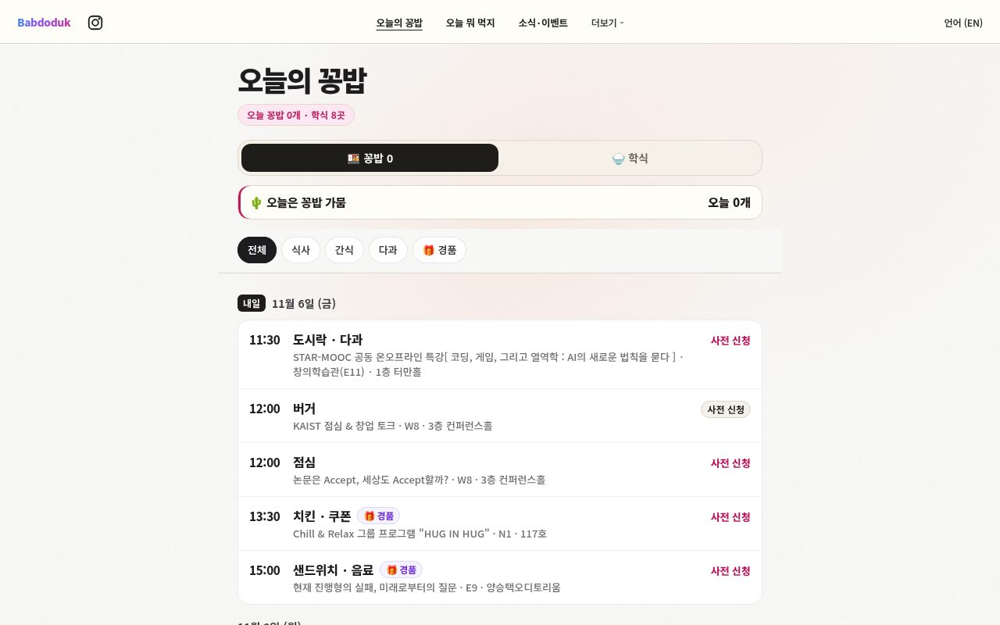
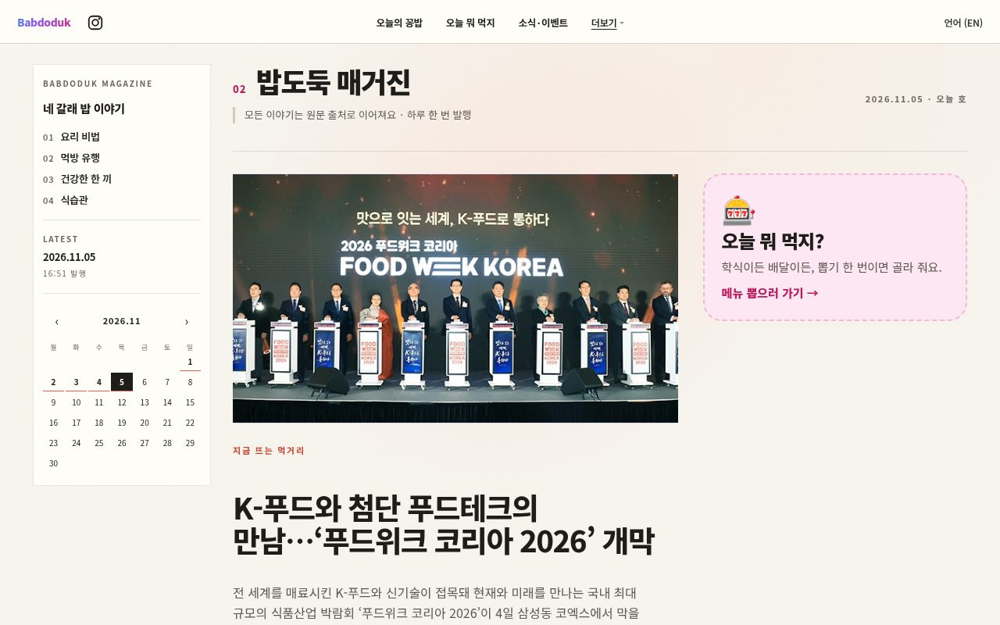
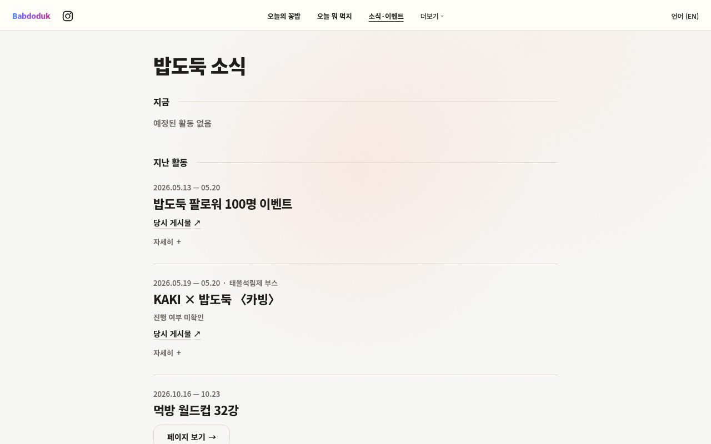
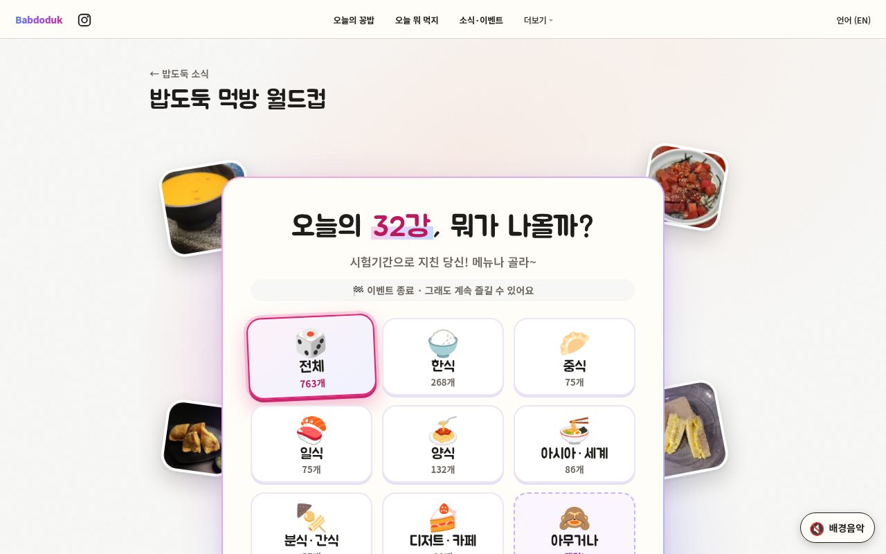
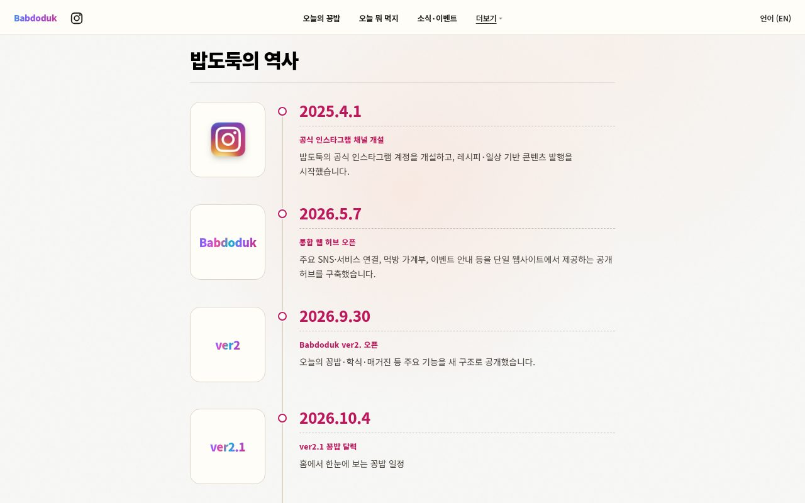
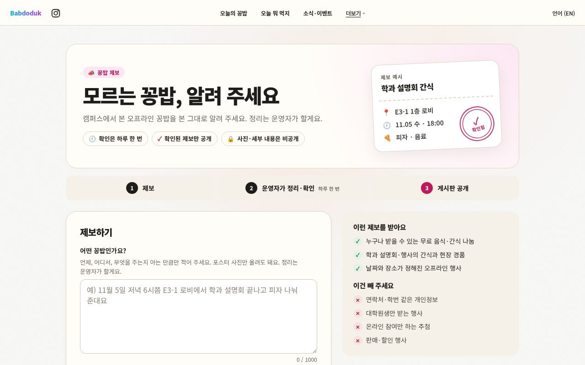
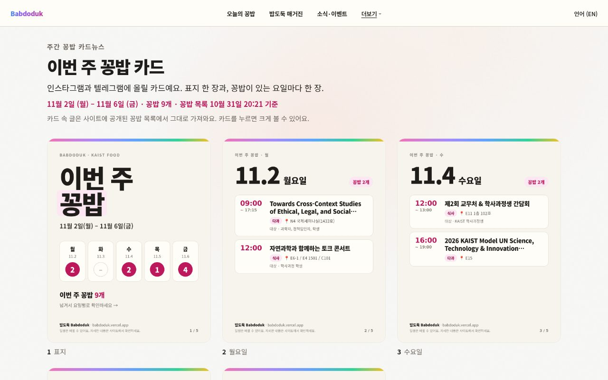
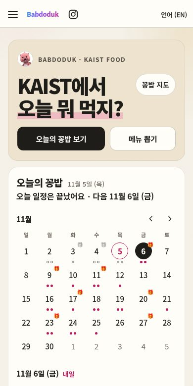

# 밥도둑 Babdoduk

**KAIST에서 오늘 뭐 먹지?** 무료 음식 일정, 이번 주 학식, 메뉴 고르기, 음식 이야기를 한곳에서 봅니다.

[사이트 열기](https://www.babdodukms.com) · [lab 미리보기](https://babdoduk-lab.vercel.app) · [인스타그램](https://www.instagram.com/babdodukms/)

주소가 **www.babdodukms.com** 으로 바뀌었어요(2026-11-02). 예전 주소 babdoduk.vercel.app 도 그대로 열려요.

## 화면

| 홈 | 오늘의 꽁밥 |
|---|---|
|  |  |
| 오늘의 꽁밥 달력과 학식 한 줄로 시작해요. | 지금 참여할 수 있는 무료 음식 일정과 이번 주 학식. 🎁 경품 행사는 따로 모아 봐요. |
| **밥도둑 매거진** | **소식·이벤트** |
|  |  |
| 음식 이야기와 '오늘 뭐 먹지?' 메뉴 고르기. | 먹방 월드컵을 시작 화면 그대로 카드에 보여 주고, 지난 활동은 기록으로 남아요. |
| **먹방 월드컵** | **역사** |
|  |  |
| "오늘의 32강, 뭐가 나올까?" 카테고리를 고르고 시작하면 700개가 넘는 메뉴 중 32개가 맞붙어요. 8강부터는 검은 화면 "진출!", 결승은 두 카드가 부딪혀요. 행사(10/16~10/23)는 끝났지만 지금도 할 수 있어요. | 밥도둑이 걸어온 길. |
| **꽁밥 제보** | **꽁밥 카드뉴스** (lab) |
|  |  |
| 캠퍼스에서 본 꽁밥을 자기 말로 적고 사진을 붙이면 끝. 정리와 확인은 운영자가 하고, 확인된 제보만 게시판에 올라가요. 모든 페이지 '더보기'에서 들어가요. | 한 주의 꽁밥을 표지 한 장과 요일별 카드로 만들어 텔레그램·인스타그램에 올려요. 꽁밥이 없는 요일은 카드를 만들지 않아요. |

*위 화면 이미지는 lab(babdoduk-lab.vercel.app) 기준이라 production과 조금 다를 수 있어요.*

### 최근 바뀐 것 (2026-11-02 배포)

- **꽁밥 제보**가 생겼어요(`tip.html`, 모든 페이지 '더보기' → 꽁밥 제보). 레이더가 못 본 오프라인 꽁밥을 방문자가 알려 줘요.
  - 칸은 "어떤 꽁밥인가요?" 하나와 사진 3장까지예요. 포스터 사진만 올려도 돼요.
  - 운영 PC가 글과 사진을 읽어 행사 이름·장소·날짜·시간·음식을 정리하고, 운영자가 텔레그램에서 ✅ 올리기 / ❌ 안 올리기 / ✏️ 고치기로 하루 한 번 확인해요.
  - 게시판에는 확인된 제보의 행사 정보만 올라가요. 제보 글, 사진, 보낸 사람 정보는 공개하지 않아요(`docs/GGONGBAB_TIPS.md`).
- **새 주소 www.babdodukms.com** 이 운영 사이트에 연결됐어요. 하단 '문의' 메일은 joshualisky@kaist.ac.kr 이에요.

**그 전 배포 (10/28)**

- **여러 날 행사는 날마다 따로** 보여요. 예를 들어 월~금 닷새 동안 하는 토크 콘서트가 금요일만 시간이 다르면, 홈 달력과 오늘의 꽁밥 모두 다섯 날을 각자의 시간·장소로 보여 줘요. 음식이나 경품을 주는 날만 넣어요.
- **누구를 위한 행사인지** 행사 아래 작은 글씨 한 줄로 보여 줘요(예: "학사과정 학생, 특히 새내기 학생"). 메일이나 포스터에 적혀 있지 않아 짐작한 대상에는 "(추정)"을 붙여요.
- 새 규칙은 다음 데이터 갱신부터 적용돼요. 그 전에 올라온 행사는 다시 읽힐 때 바뀌어요.

**그 전 배포 (10/14~10/15)**: 🎁 경품 행사는 배지와 필터로 따로 보여 주고 무료 음식 개수에는 세지 않아요. 포스터에서만 읽은 음식 정보에는 "포스터 기준"이라고 표시해요. 먹방 월드컵 시작 화면, 소리와 효과음, 인스타 스토리 카드와 친구 도전 링크가 생겼어요(`docs/WORLDCUP_SHARE.md`). 강조색이 밥도둑 분홍색이 되었어요.

### lab에만 있는 것

- **꽁밥 레이더**가 Dooray 메일을 통째로 읽어요. 첨부(PDF·HWP 등)와 포스터까지 보고, 안 읽은 메일도 읽은 뒤 안 읽음 표시를 되돌려 놓아요. 레이더는 운영 PC에서 lab 코드로 돌고, 찾은 메일은 비공개 수집함을 거쳐 본편과 같은 추출·검증을 받아요.
- **운영 PC**(리눅스, 2026-10-17부터)에서 레이더와 포털 공지 수집기가 계속 돌아요. 문제가 생기면 텔레그램으로 알려 주고, 운영 Chrome이 꺼지면 다시 열어요. KAIST 로그인이 풀리면 간편 로그인을 시작해 승인 번호를 텔레그램으로 보내 줘서, 휴대폰에서 숫자 하나만 누르면 다시 이어져요. 그때 바로 못 눌렀으면 나중에 텔레그램에서 🔑 버튼을 누르거나 "로그인"이라고 보내면 새 승인 번호가 와요. 비밀번호는 저장하지도 입력하지도 않아요(lab 브랜치의 `docs/GGONGBAB_RESIDENT_OPS.md`, `docs/PORTAL_EASY_LOGIN_ASSIST.md`).
- **인스타 레이더**(2026-10-29부터)가 학부 학과·학생회·학생 단체 인스타그램 32개 계정을 Meta 공식 API로 3~6시간마다 확인해요. 10/26 이후 게시물만 보고, 꽁밥으로 판정된 행사는 레이더처럼 비공개 수집함을 거쳐요. 애매하거나 시간이 없는 행사는 텔레그램으로 운영자에게 먼저 물어봐요. 대학원 계정은 넣지 않아요(lab 브랜치의 `docs/INSTAGRAM_RADAR.md`, `docs/INSTAGRAM_SOURCES.md`).
- **먹방 월드컵**에서 끝난 판을 익명 합계로 모은 '모두의 랭킹'과 직전 경기 승률은 lab에만 있어요(`docs/WORLDCUP_STATS.md`).
- **꽁밥 카드뉴스**(2026-11-02부터): 매주 월~금 꽁밥을 표지 + 요일별 카드(1080×1350)로 그려요. 공개된 꽁밥 목록에서 그대로 가져오고, 꽁밥이 없는 요일과 제보로만 들어온 꽁밥은 카드로 만들지 않아요. 기본 양식은 `inputs/cardnews/`에 고정해 두고 필요할 때 바꿔요. 시안은 lab의 `cardnews.html`에서 보고, 확인한 뒤 텔레그램으로 보내요. 카드는 한 달만 보관해요(lab 브랜치의 `docs/CARDNEWS.md`).
- **운영 비서**(2026-10-31부터): 운영자가 텔레그램 봇에 남긴 메시지를 운영 PC가 운영 상태와 함께 읽고 답해요. 정해 둔 조치(작업 재시작, 로그인 승인 다시 요청, 운영자가 ✅ 한 뒤의 메일 다시 읽기)만 하고 나머지는 운영자에게 물어봐요(lab 브랜치의 `docs/OPS_AGENT.md`).
- **홈 정리**: 홈은 첫 화면(오늘의 꽁밥 달력과 학식)만 남기고 그 아래 '01 오늘 먹기 · 02 읽어보기 · 03 밥도둑 소식'을 뺐어요. 아직 lab에만 있어요.
- **실험 메뉴**: babdoduk-lab 주소에서만 '더보기'에 실험실 · 꽁밥 실험 · 카드뉴스가 보여요. 실험 페이지는 운영 주소에서는 404예요.

## 어떻게 돌아가나



학식·공지·메일 → GitHub Actions(수집·검증) → 정적 JSON(`data/`) → 페이지(HTML·CSS·JS) → Vercel (www.babdodukms.com)

- 빌드 단계가 없는 정적 사이트예요. 브라우저는 같은 사이트의 JSON만 읽어요.
  꽁밥 제보 페이지만 예외로, 공개 키로 제보를 보내고 확인된 제보 게시판을 읽어요(검사하는 함수만 부를 수 있어요).
- 데이터는 만든 시점의 스냅숏이라, 화면에 날짜나 마지막 변경 시각을 함께 보여 줘요.
- 생성이나 검증이 실패하면 이전 파일이 그대로 남아요.

<br clear="right" />

## 시작하기

```bash
python scripts/check_ggongbab_ui.py --serve   # http://127.0.0.1:8000 에서 미리보기
python -m pytest tests -q                     # 테스트
python scripts/validate_content.py            # 데이터 검증
python scripts/sync_site_chrome.py --check    # 공용 메뉴·번역이 페이지와 맞는지
python scripts/check_site_ui.py               # 모든 페이지 화면 검사
```

## 작업 규칙

1. 최신 `origin/lab`에서 작업 브랜치를 만들어요.
2. `lab`에 합쳐 https://babdoduk-lab.vercel.app 에서 한·영, 휴대폰·데스크톱으로 확인해요.
3. 소유자가 승인하면 승인된 커밋만 `main`으로 옮겨요. lab 전체를 main에 합치지 않아요.
4. 배포 뒤에는 back-sync로 `lab`을 본편과 맞춰요. 아래 명령의 출력이 없어야 해요.

```bash
git log --format='%h %an %s' origin/lab..origin/main | grep -v babdoduk-content-bot
```

규칙 전체는 [AGENTS.md](AGENTS.md), 배포는 [docs/DEPLOYMENT_AND_BRANCHES.md](docs/DEPLOYMENT_AND_BRANCHES.md),
브랜치 정리는 [docs/REPOSITORY_HYGIENE.md](docs/REPOSITORY_HYGIENE.md)에 있어요.

## 문서

| 알고 싶은 것 | 문서 |
|---|---|
| 페이지·데이터·파이프라인·수집·검증·배포 자세히 | [docs/GUIDE.md](docs/GUIDE.md) |
| 제품 범위 · 디자인 · 구조 | [PRD.md](PRD.md) · [DESIGN_SYSTEM.md](DESIGN_SYSTEM.md) · [ARCHITECTURE.md](ARCHITECTURE.md) |
| 데이터 파일 계약 | [docs/DATA.md](docs/DATA.md) |
| 오늘의 꽁밥 · 홈 달력 | [docs/GGONGBAB_PAGE.md](docs/GGONGBAB_PAGE.md) · [docs/HOME_CALENDAR.md](docs/HOME_CALENDAR.md) |
| 꽁밥 제보 | [docs/GGONGBAB_TIPS.md](docs/GGONGBAB_TIPS.md) |
| 학식 | [docs/KAIST_MENU.md](docs/KAIST_MENU.md) |
| 매거진 | [docs/MAGAZINE_DISCOVERY.md](docs/MAGAZINE_DISCOVERY.md) · [docs/MAGAZINE_SOURCES.md](docs/MAGAZINE_SOURCES.md) |
| 소식·이벤트 쓰는 법 | [docs/EVENT_DETAIL_FIELDS.md](docs/EVENT_DETAIL_FIELDS.md) |
| 화면 기준 이미지 | [docs/VISUAL_BASELINES.md](docs/VISUAL_BASELINES.md) |

## 라이선스

코드는 [MIT](LICENSE), 매거진 자료원 등록부(`scripts/discovery/sources.json`)는 CC0 1.0이에요.
밥도둑 이름과 로고, `images/`의 사진·캐릭터, `data/`의 생성 데이터는 각 권리자의 것이에요.
먹방 월드컵 사진은 위키미디어 공용의 자유 이용 사진으로, 작가와 라이선스를 사진마다 표시해요.
